 
==============

Fibonacci
=========

The recursive Fibonacci is a benchmark that can be used to compare different
implementations of the same language. The most recent effort in implementing
Joy is called HET and that gives the starting point of the comparison. All
timings differ from the previous version of this document.

HET
---

The Fibonacci benchmark measures function call overhead. HET has some overhead,
because every time a function is executed, the body of the function gets copied
to the program stack. When functions written in C are called, these functions
need to be searched in the symbol table. When integers are used, they need to
be converted from presentation format to binary format. And all of that needs
to be stored in memory that is allocated from the heap. The result of
calculating fib(35) is given in this picture:

 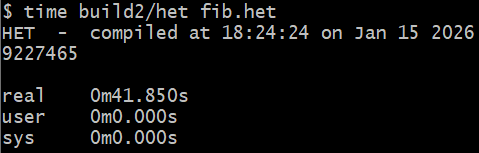

HET was compiled with 64-bit Msvc.

42minjoy
--------

The next candidate for comparison is 42minjoy, because this minimal
implementation is quite similar to HET. The body of a function is not copied
to a program stack; instead the function `joy` calls itself when evaluating
the body of a function. Functions are only searched in the symbol table once,
when reading the text of the function; function addresses are used when
evaluating a function. Integers are available in binary format. And the
garbage collector is used, whenever the memory array has been fully used.

 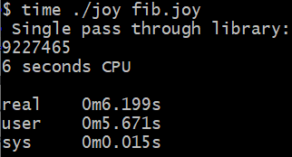

42minjoy, the ugly duck, is now leading the pack as the fastest implementation.
How did that happen? Well, firstly it doesn't read the library files. And
secondly, all checks, diagnostics, and statistics have been turned off.

joy0
----

The super original Joy uses a copying collector that is faster than the
mark/scan collector used in 42minjoy. But, it reads the library files and
gives statistics. That makes it slower than 42minjoy.
 
 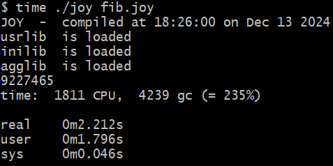

Legacy
------

The legacy version is similar to joy0, except that it has more builtins. This
makes the binary a bit slower than joy0.

 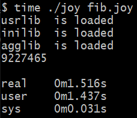

JOY
---

The original Joy is similar to the Legacy version, but uses a flexible array as
memory area. This comes with a price: performance is lower. On the other hand
it is more comparable with joy1 in the type of programs that can be processed.

 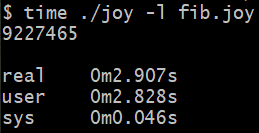

The `-l` option prevents the loading of standard libraries.

joy1
----

The original Joy with a simplified utils.c, linked with the BDW garbage
collector.

 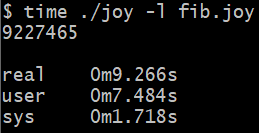

This one is slower than Joy. Allocating many small nodes is not a good fit for
a garbage collector.

 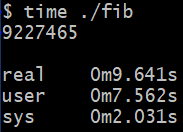

The compiled version of joy1, linked with the BDW garbage collector, is faster.
Even so, it is slower than Joy.

Foy
---

Foy is a Forth-inspired Joy that implements stack and code with flexible arrays.

 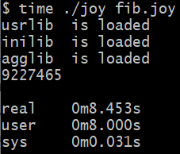

Moy
---

Moy also uses flexible arrays, different from the ones in Foy.

 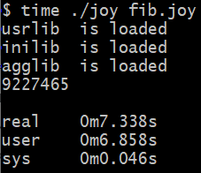

Soy
---

Soy uses the same code as Moy, compiled to a stand-alone binary.

 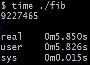

It is bit slower than Moy and this is surprising. Is compilation not supposed
to make a program faster?

Roy
---

Roy uses code that differs from Moy. It allows recursion on the hardware stack.

 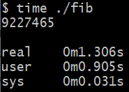

That makes it the fastest of all implementations.

Summary
-------

+----------+--------+
| Binary   | Timing |
+==========+=======:+
| HET\     | 41.85\ |
| 42minjoy\|  1.22\ |
| joy0\    |  1.30\ |
| Legacy\  |  1.52\ |
| JOY\     |  2.64\ |
| joy1\    |  9.27\ |
| Foy\     |  5.37\ |
| Moy\     |  5.51\ |
| Soy\     |  5.75\ |
| Roy      |  0.97  |
+----------+--------+

\newpage

Source code
===========

HET
---

    #define sub     sub $
    #define add     add $
    #define less    less $

    (a % ; b % ; a * b *) swap : ;
    #define swap    swap * !

    (a % a *) dup : ;
    #define dup     dup * !

    ( () t : ;
      (1 sub dup fib_rec * ! swap 1 sub fib_rec * ! add) f : ;
    dup 2 less * !) fib_rec : ;
    #define fib_rec fib_rec * !

    35 fib_rec .

Note that this source must be run through the C preprocessor before it can be
executed.

42minjoy
--------

    fib == [small] [] [pred dup pred] [+] binrec.
    35 fib.

The source code is no longer in two files. And 42minjoy now has `small`,
`pred`, and `binrec` builtin. The simpler setup helps performance.

joy0
----

    0 __settracegc.
    35 [small] [] [pred dup pred] [+] binrec.

The `__settracegc` is needed in order to prevent many messages about the
garbage collector that would slow the program down.

Legacy, Joy, and joy1
---------------------

    35 [small] [] [pred dup pred] [+] binrec.

Legacy, Joy, and joy1 do not need `__settracegc`.

Foy, Moy, Soy, and Roy
----------------------

    35 [dup small] [] [pred dup pred] [+] binrec.

Foy and Moy benefit from using `dup` in the condition; Soy and Roy require it.

Conclusion
==========

HET is slowest, by far, followed by joy1. Roy is fastest, followed by 42minjoy.
Roy is faster than 42minjoy, because it is compiled to C. And so is Soy, but
Soy uses the exact same code as Moy.
