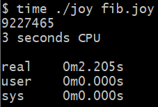

 
==============

Fibonacci
=========

The recursive Fibonacci is a benchmark that can be used to compare different
implementations of the same language. The most recent effort in implementing
Joy is called HET and that gives the starting point of the comparison. All
timings differ from the previous version of this document.

HET
---

The Fibonacci benchmark measures function call overhead. HET has some overhead,
because every time a function is executed, the body of the function gets copied
to the program stack. When functions written in C are called, these functions
need to be searched in the symbol table. When integers are used, they need to
be converted from presentation format to binary format. And all of that needs
to be stored in memory that is allocated from the heap. The result of
calculating fib(35) is given in this picture:

 

HET was compiled with 64-bit msvc.

42minjoy
--------

The next candidate for comparison is 42minjoy, because this minimal
implementation is quite similar to HET. The body of a function is not copied
to a program stack; instead the function `joy` calls itself when evaluating
the body of a function. Functions are only searched in the symbol table once,
when reading the text of the function; function addresses are used when
evaluating a function. Integers are available in binary format. And the
garbage collector is used, whenever the memory array has been fully used.

 

42minjoy requires a 32-bit compiler, in this case mingw32 was used. It could
be made a bit faster by making `pred` a builtin.

 

And this is the result when `pred` is available as builtin. It doesn't change
the ranking, given later on, but it comes closer to the Legacy version.
Unlike the full version of Joy, 42minjoy does not compile the function address
into the factors that are read from source code; instead it compiles the index
into the symbol table. This requires a lookup at runtime. And yet, the
performance does not differ all that much.

\newpage

joy0
----

The super original Joy uses a copying collector that is faster than the
mark/scan collector used in 42minjoy. Also, it has `pred` as builtin.

 

Joy0 requires a 32-bit compiler, in this case mingw32 was used. It is faster
than the Legacy version, maybe because it is smaller?

Legacy
------

The legacy version is similar to joy0, except that it has more builtins. This
makes the binary a bit slower than joy0.

 

The Legacy version requires a 32-bit compiler, in this case mingw32 was used.

\newpage

JOY
---

The original Joy is similar to the Legacy version, but uses a flexible array as
memory area. This comes with a price: performance is lower. On the other hand
it is more comparable with joy1 in the type of programs that can be serviced.

 

Joy and all other repositories that follow are compiled with a 64-bit compiler,
gcc. The `-l` option prevents the loading of standard libraries.

joy1
----

The original Joy linked to the BDW garbage collector.

 

This one is slower than Joy. Allocating many small nodes is not a good fit for
a garbage collector.

 

The compiled version of joy1 is a little bit faster, not worth the trouble of
compiling. The dominant factor is the memory model. However fast the garbage
collector, it cannot allocate the memory nodes that fib needs fast enough.

Foy
---

Foy is a Forth-inspired Joy that uses vectors for stack and code.

 

Moy
---

Moy also uses vectors for stack and code. The implementation of its vectors
differ from those of Foy.

 

Soy
---

Soy uses the same code as Moy, compiled to a stand-alone binary.

 

It is bit slower than Moy and this is surprising. Is compilation not supposed
to make a program faster?

\newpage

Roy
---

Roy uses code that differs from Moy. It allows recursion on the hardware stack.

 

That makes it the fastest of all implementations.

Summary
-------

+----------+--------+
| Binary   | Timing |
+==========+=======:+
| HET\     | 41.85\ |
| 42minjoy\|  2.82\ |
| joy0\    |  1.70\ |
| Legacy\  |  2.01\ |
| JOY\     |  2.90\ |
| joy1\    | 10.19\ |
| Foy\     |  5.37\ |
| Moy\     |  5.51\ |
| Soy\     |  5.75\ |
| Roy      |  0.97  |
+----------+--------+

\newpage

Source code
===========

HET
---

    #define sub     sub $
    #define add     add $
    #define less    less $

    (a % ; b % ; a * b *) swap : ;
    #define swap    swap * !

    (a % a *) dup : ;
    #define dup     dup * !

    ( () t : ;
      (1 sub dup fib_rec * ! swap 1 sub fib_rec * ! add) f : ;
    dup 2 less * !) fib_rec : ;
    #define fib_rec fib_rec * !

    35 fib_rec .

Note that this source must be run through the C preprocessor before it can be
executed.

42minjoy
--------

    fib    	==  [2 <] [] [pred dup pred] [+] binrec ;
    pred	==  1 -                 .

    35 fib.

The source code is no longer in two files. And 42minjoy now has `binrec`;
it doesn't have `pred` as builtin.

joy0
----

    0 __settracegc.
    35 [small] [] [pred dup pred] [+] binrec.

The `__settracegc` is needed in order to prevent many messages about the
garbage collector that would slow the program down.

Legacy, Joy, and joy1
---------------------

    35 [small] [] [pred dup pred] [+] binrec.

Legacy, Joy, and joy1 do not need `__settracegc`.

Foy, Moy, Soy, and Roy
----------------------

    35 [dup small] [] [pred dup pred] [+] binrec.

Foy and Moy benefit from using `dup` in the condition; Soy and Roy require it.

Conclusion
==========

HET is slowest, by far, followed by joy1. Roy is fastest, followed by joy0.
Roy is faster than joy0, because it is compiled to C. And so is Soy, but Soy
uses the exact same code as Moy.
